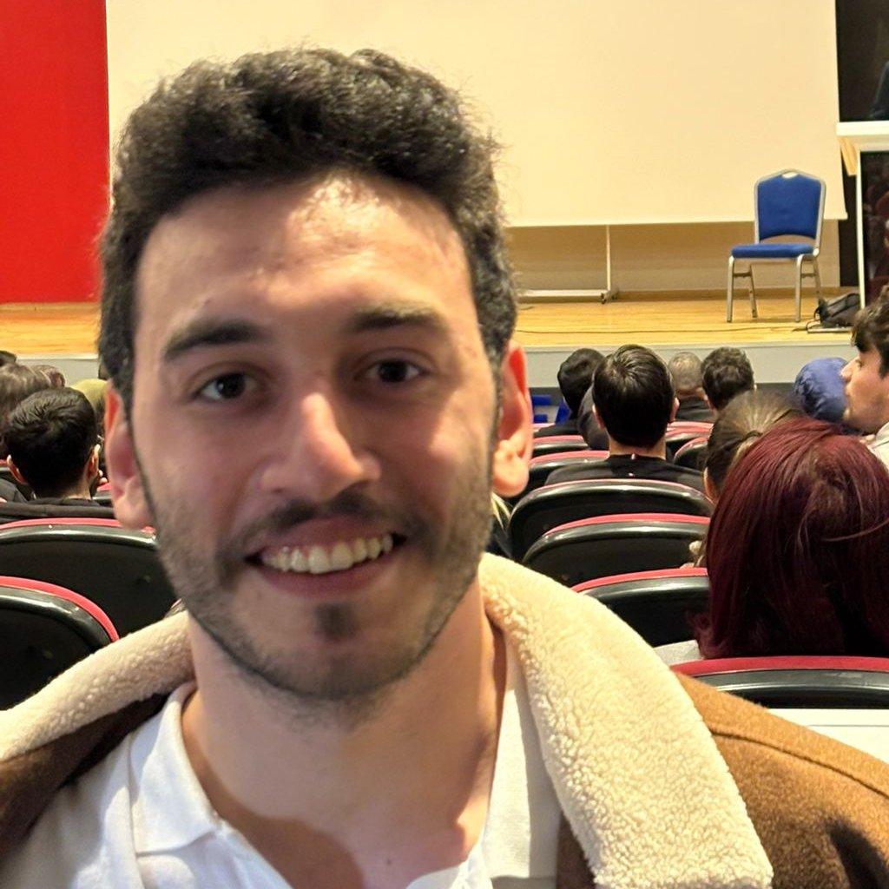

# ⚡ Ahmet Şafak Şenel — Data Scientist & Computer Engineer Portfolio

[](https://portfolio-q663.vercel.app)
[](https://portfolio-two-blush-qly1y5rrlz.vercel.app/api/docs)

Modern, high-aesthetic personal portfolio platform engineered with **Next.js 16.4**, **React 19.3**, **Python 3.14**, **PyTorch**, **Intel OpenVINO**, **DuckDB OLAP**, **Django 6.1**, **Tailwind CSS v4**, and **Supabase (PostgreSQL 17)**.



---

## 🌟 Key Features

- 🌍 **Bilingual Support (TR & EN):** Seamless runtime language switching across all sections, projects, and metadata.
- 🌓 **Dark & Light Mode:** Theme switcher supporting deep space dark mode (`#060609`) and clean, modern light mode with glassmorphic cards.
- 💻 **Interactive AI & ML Terminal:** Live simulation of FLO Group 22 Turkish BERT models with OpenVINO INT8 CPU inference (14.2ms), YZTA Datathon Stacking ML, and Agentic Copilot with DuckDB OLAP.
- 📐 **Bento Grid & Spotlight Cards:** Dynamic radial spotlight effects highlighting Applied AI, NLP, Agentic Multi-Agent graphs, and MLOps.
- 🚀 **Filterable Engineering Projects:** Categorized showcases (Data Science & AI, MLOps, Scraping, Full-Stack) with real-world metrics, architecture deep-dives, and GitHub repos.
- 📬 **Direct Contact & Bot Protection:** Personal contact form integrated with Django Ninja REST API and Supabase with honeypot anti-spam protection.
- 📄 **Curriculum Vitae (CV):** Direct access and download for both Turkish and English resumes.

---

## 🛠️ Tech Stack & Architecture

### Frontend
- **Framework:** Next.js 16.4.1 (App Router, Turbopack, React 19.3, TypeScript 5.8)
- **Styling:** Tailwind CSS v4.3+ (CSS-first `@theme`, Oxide engine)
- **Animations:** Motion (`motion/react` v14.2), Lenis Smooth Scroll, GSAP 3.15
- **Icons:** Lucide React & Custom Brand Icons

### Backend
- **Language & Runtime:** Python 3.14.8
- **Framework:** Django 6.1.2 + Django Ninja 1.3 (Pydantic v2 validation, `/api/docs` OpenAPI/Swagger)
- **Database Driver:** Psycopg 3 (`psycopg[binary,pool]>=3.2.0`)
- **Serverless:** Vercel Python WSGI / ASGI integration

### Database & Cloud
- **Database:** Supabase PostgreSQL 17.11 (Supavisor Transaction Pooler Port 6543)
- **Security:** Row Level Security (RLS) enabled on all tables
- **Deployment:** Vercel Serverless

---

## 🚀 Local Development

### 1. Backend Setup
```bash
cd backend
py -3.14 -m venv .venv
# On Windows
.venv\Scripts\activate

pip install -r requirements.txt
python manage.py migrate
python manage.py seed_portfolio
python manage.py runserver 127.0.0.1:8000
```
Swagger UI available at `http://127.0.0.1:8000/api/docs`.

### 2. Frontend Setup
```bash
cd frontend
npm install
npm run dev
```
Portfolio opens at `http://localhost:3000`.

---

## 📄 License & Author

Developed by **Ahmet Şafak Şenel**  
- GitHub: [@safaksenel](https://github.com/safaksenel)  
- LinkedIn: [in/safaksenel](https://linkedin.com/in/safaksenel)  
